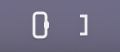
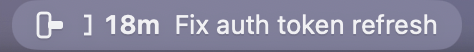
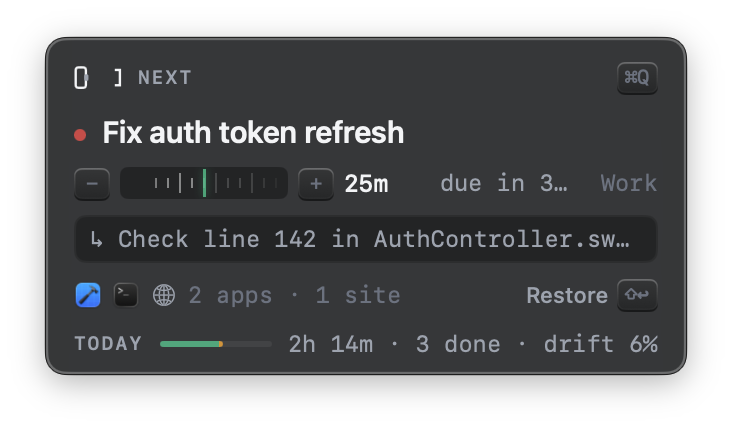
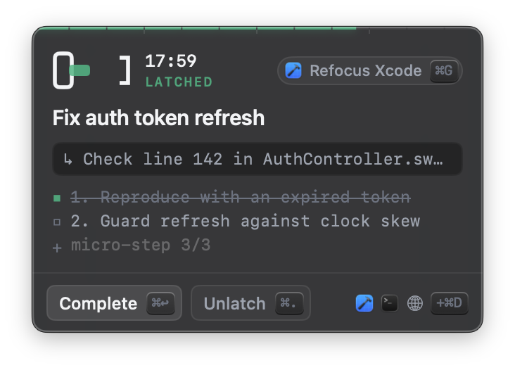
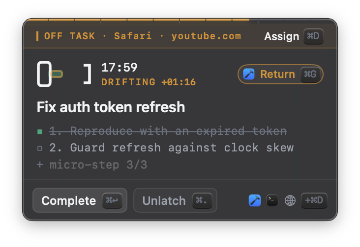
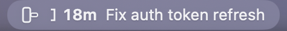
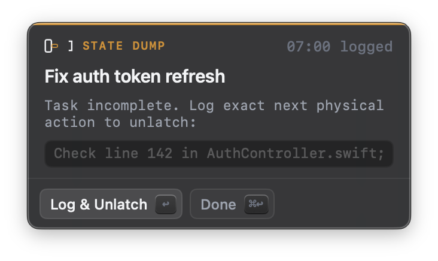
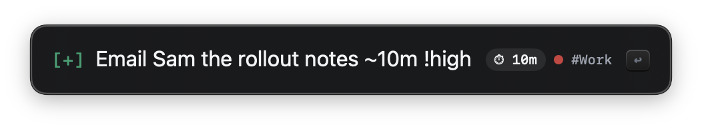
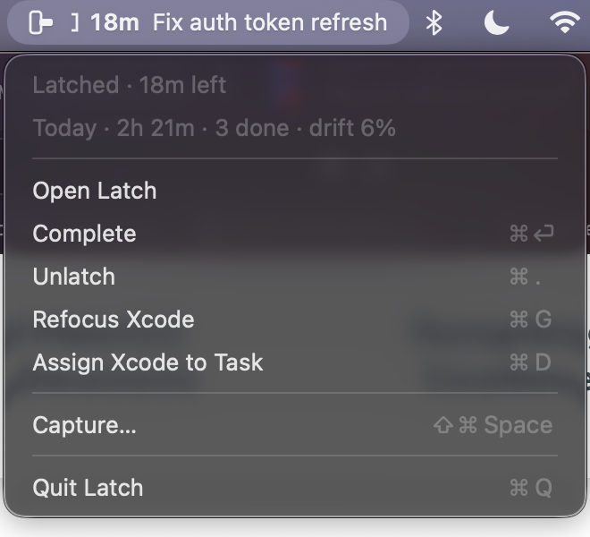

# Latch

A menu bar execution lock for macOS 14+. Apple Reminders holds the backlog; Latch only ever shows you **one** task — the one you're doing.

<p>
  
  &nbsp;
  
</p>

## Walkthrough

### 1. Pick one task

Click the deadbolt in the menu bar. Latch scores your incomplete reminders (priority, due date, whether it fits before your next meeting) and shows only the best one.



- **Duration dial** — drag, scroll, or press `-` / `=` to set the session in 5-minute steps. If a meeting would interrupt, an amber `CLAMPED` banner shortens the session to end 5 minutes before it.
- **↳ resume note** — the exact next step you logged last time, so there's no warm-up.
- **Workspace row** — the apps and sites assigned to this task. **Restore ⇧↩** latches *and* reopens them.
- **TODAY** — one bar toward your daily goal: emerald for focused time, amber for drift.
- **↩** latch · **⇥** show the next-best task · **⌘1** only tasks of 15 minutes or less.

### 2. Latch

The bolt throws home with a soft haptic, and the menu bar starts telling time with geometry: the bolt slides toward the keeper as the session is spent, next to a coarse `18m` that switches to seconds in the final minute.



- **Refocus ⌘G** jumps back to the app you latched from.
- **Micro-steps** — break the task into up to three steps; click to tick one off.
- **Workspace icons** (bottom right) — **+ ⌘D** assigns the app or site you came from; right-click an icon to remove it.
- **Complete ⌘↩** marks the reminder done. **Unlatch ⌘.** stops the clock.

### 3. Stay on task — workspaces and Drift Guard

A task rarely lives in one app. Its **workspace** is everything it legitimately uses: whole apps (Xcode, Terminal) and specific **sites** in Safari, Chrome, Arc, Edge, Brave or Vivaldi (github.com, docs.swift.org — subdomains included). Moving between them is on-task.

Go anywhere else for longer than the grace period (20s) and you're **drifting**:



- The banner says exactly where you went. If it *is* part of the task, **Assign ⌘D** adds it to the workspace and the excursion is forgiven.
- Otherwise **Return ⌘G** takes you back.
- The menu bar bolt blinks hollow once a second — noticeable in your peripheral vision, never an alarm.



Quick glances shorter than the grace period never count, and opening Latch itself is neutral. Workspaces are saved in the reminder, so they follow the task across Macs.

### 4. Leave cleanly — the state dump

You can't walk away from an unfinished task without saying what comes next. Unlatching (or running out the clock) opens the gate:



Type the next physical action and press **↩**; it becomes the resume note on the card next time. Or press **⌘↩** if you actually finished. Time and drift for the session are logged into the reminder.

### 5. Capture without looking

From any app, even fullscreen, **⌘⇧Space** opens a single line that never shows your backlog. Inline tokens set duration, priority and list:



`~15m` / `~1h` duration · `!high` `!med` `!low` (or `!1`–`!3`) priority · `#List` routes to a Reminders list. **↩** saves and hands focus straight back; **Esc** discards.

### 6. The right-click menu



Status and today's summary at a glance, plus every action — including **Assign … to Task** for whatever app or site you're in — without opening the popover.

## Features in detail

### The Deadbolt token

A housing, a bolt and a keeper. While you're latched the bolt slides toward the keeper as time is spent; at 00:00 it's seated, and overtime counts up as `+2m`. It's a template image with a native title, so it tints like system icons on light, dark and accent-tinted menu bars. Paused and drifting sessions draw the bolt hollow.

### Keeping the item visible

macOS hides menu bar items that don't fit, and on notched MacBooks they disappear behind the notch.

- **⌘-drag the item** to where you want it (for example, nearer the clock). Latch remembers the position.
- When the full item is hidden, Latch **collapses to the bolt and time**, then retries the full width when your displays change and every 5 minutes.
- On macOS 26, also check **System Settings → Menu Bar** that Latch is allowed in the menu bar.

### Workspace restore

**Restore ⇧↩** on the selector latches and rebuilds the task's setup: it launches assigned apps that aren't running, opens assigned sites that no tab is already on (so it never duplicates), brings the first assigned app forward, and pins the session to it.

### Today ledger

A single day, kept on this Mac: focused time, drift, sessions and completions. Shown as the **TODAY** bar in the selector and as a line in the right-click menu. No history and no streaks — tomorrow starts at zero.

## Keys

| Where | Key | Action |
|---|---|---|
| Anywhere | ⌘⇧Space | Blind Capture (`~15m`, `!high`/`!1`, `#List`) |
| Selector | ↩ / ⇧↩ | Latch / Latch & restore the workspace |
| Selector | ⇥ / ⌘1 | Next-best task / Quick ≤15m filter |
| Selector | − / = / drag / scroll | Duration −/+ 5m on the dial |
| Focus | ⌘↩ / ⌘. | Complete / Unlatch |
| Focus | ⌘G / ⌘D | Refocus (or Return to) the pinned app / Assign where you are to the workspace |
| State dump | ↩ / ⌘↩ | Log next action & unlatch / Mark done |

## Permissions

| Permission | Needed for | |
|---|---|---|
| Reminders | Everything | Required |
| Calendars | Clamping sessions before meetings | Optional |
| Automation (per browser) | Recognising **sites** in your workspace | Optional — asked the first time Latch reads that browser's tab |

Latch only *reads* the current tab's address; it never changes or navigates your tabs. Without Automation access, a browser tab Latch can't read is given the benefit of the doubt rather than counted as drift.

## Optional defaults

```bash
defaults write app.latch.Latch LatchTargetList "Work"          # only pull candidates from one list
defaults write app.latch.Latch LatchHardStop -bool YES         # at 00:00 go straight to the state dump (no overtime)
defaults write app.latch.Latch LatchDriftGraceSeconds -int 45  # Drift Guard grace period (0 = strict)
defaults write app.latch.Latch LatchDriftGuardDisabled -bool YES
defaults write app.latch.Latch LatchDailyGoalMinutes -int 300  # the TODAY bar's goal (default 240)
```

## Build & run

```bash
scripts/build-app.sh && open build/Latch.app
```

Use the bundled `.app`, not `swift run`: Reminders, Calendar and Automation access need the usage strings in `Support/Info.plist`.

`swift test` runs the `LatchCore` suite: metadata and capture parsers, scoring, calendar clamping, time formatting, the Deadbolt geometry and labels, Drift Guard, workspaces and focus scope, browser scripts, restore planning, and the day ledger.

### Demo mode and screenshots

Every screenshot above comes from **demo mode** — sample tasks in memory, never your Reminders:

```bash
scripts/screenshots.sh                                          # regenerate docs/screenshots/
open -n build/Latch.app --args -LatchDemoScene latched          # explore a scene by hand
```

Scenes: `menubar`, `selector`, `latched`, `drifting`, `gate`, `capture`, `menu`. The script quits any running Latch first, and the terminal needs Screen Recording permission.

## Layout

- `Sources/LatchCore` — pure, tested logic (`Parsers/`, `Models/`, `Logic/`).
- `Sources/Latch` — the app: `App/` (status item, delegate), `Core/` (engine, task store, EventKit, browser bridge, restore, ledger, hotkey), `UI/`, and `Demo/`.
